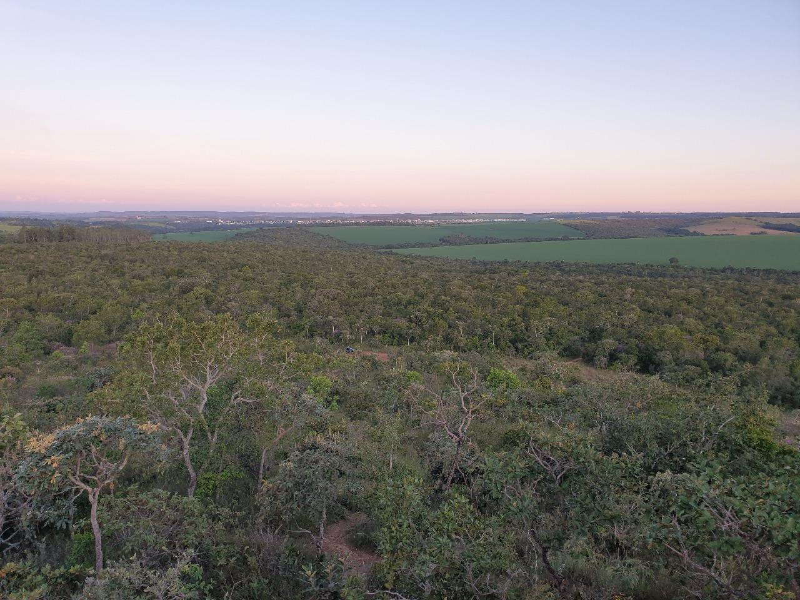
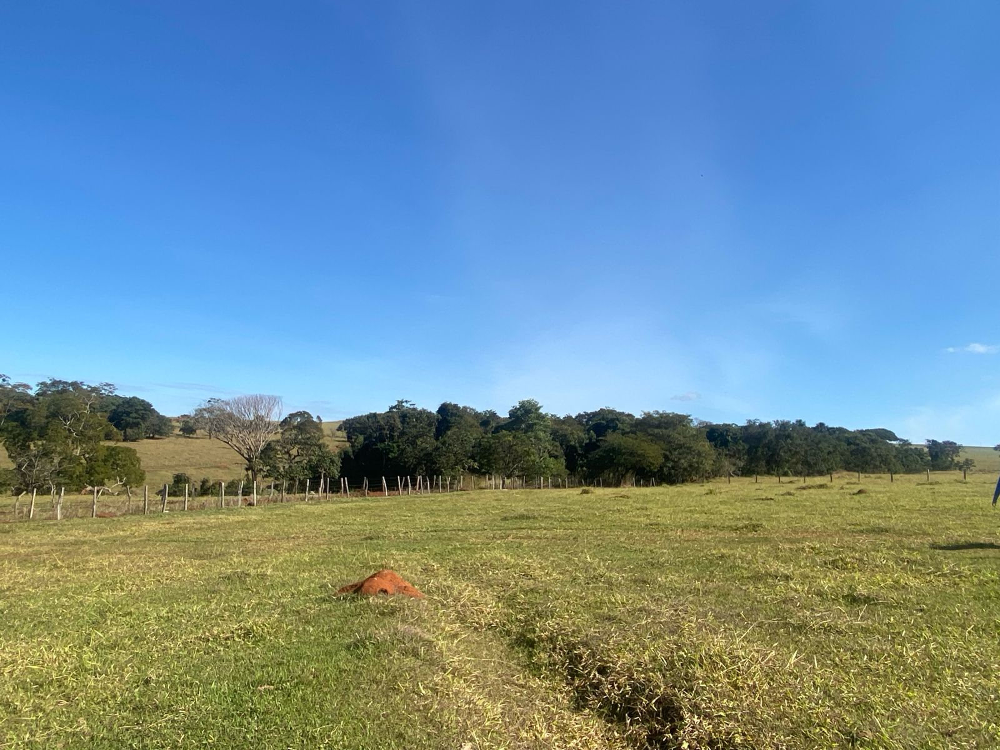

<h1>LAND LTER Project</h1>

LAND LTER (Agricultural Landscape Dynamics and Impacts on Biodiversity) is a Long-Term Ecological Research
(LTER) project underway in the Brazilian Cerrado since 2016 (in Portuguese LAND PELD). This project assesses the interactions between agroecosystems and natural vegetation remnants and their complexity in intensive farming
agricultural landscapes in the Cerrado. The landscape is a mosaic of crops, comprising mainly soybean, maize, millet, sorghum in crop rotation system, and pasturelands, interspersed by
small patches of natural vegetation remnants, such as savannas, forests, and wetlands.

  
  

We are assessing how spatial and temporal characteristics of agricultural landscapes can influence biodiversity and  its interactions, ecosystem functions, and ecosystem services. The biodiversity
has been analysed in a multi-taxon approach (plants - savannas and forests, freshwater organisms, helminth organisms, Euglossini bees, birds, small non-flying mammals, anurans, reptiles, 
and medium and large mammals). Also, non-invasive methods for biodiversity monitoring have been used, such as genetic data (Environment DNA) and remote sensing data 
(optical remote sensing data and LIDAR). 

The LAND LTER project is led by <a href="https://collevattilab.com/">Prof. Rosane Collevatti</a> at Universidade Federal de Goiás (UFG)

<h3>All biodiversity raw data obtained since 2016 are available in this repository for download</h3>
<h3>To download and plot biodiversity data in R program</h3>

<ol>
  <li>In your computer, create a folder named <code>Biodiversity_tables</code></li>
  <li> In this folder save the script: <a href="https://github.com/landlter-project/landlter-project_biodiversity_raw_data/blob/main/Biodiversity_tables/plot_biodiversity.R"><code>plot_biodiversity.R</code></li>
  <li>Open the script in RStudio</li>
  <li>Go to <strong>Session → Set Working Directory → To Source File Location</strong></li>
  <li>Click in <strong>Source</strong></li>
</ol>

<h3>To overlap the biodiversity data and land use type in R program</h3>

<ol>
  <li>In your computer, create a folder named <code>spatial_data</code></li>
  <li> In this folder save the script: <a href="https://github.com/landlter-project/landlter-project_biodiversity_raw_data/blob/main/spatial_data/vegetation_type_in_points.R"><code>vegetation_type_in_points.R</code></li>
  <li>Open the script in RStudio</li>
  <li>Go to <strong>Session → Set Working Directory → To Source File Location</strong></li>
  <li>Click in <strong>Source</strong></li>
</ol>

<em>Please cite this repository and LAND LTER publications when using these data.</em>

<h1>See LAND LTER publications here</h1>

  

<h1>Contact us</h1>

📧landlter.project@gmail.com

📷 <a href="https://www.instagram.com/lab.collevatti/">@lab.collevatti</a>

LAND LTER - Agricultural landscape dynamics and impacts on biodiversity: the dataset of a long-term ecological project ©️ 2026 by Rosane G Collevatti is licensed under CC BY-NC-SA 4.0
